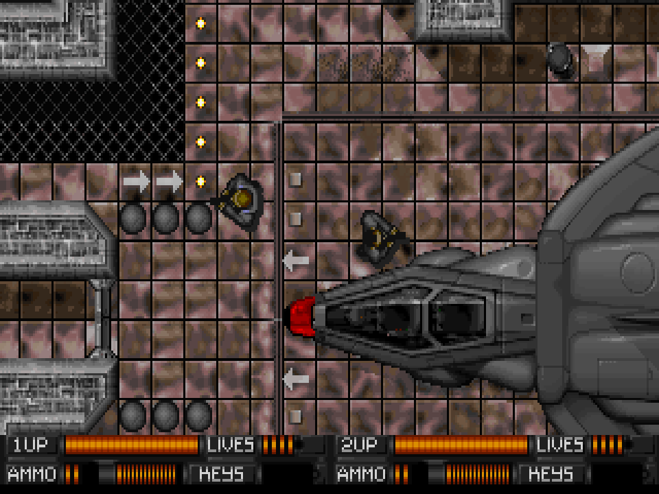

# Alien Breed web port

A vanilla JavaScript port of the IBM PC edition of Alien Breed (Team17 / A.V.M., 1993) that runs in the browser from your own original game files. The whole game is playable: start-up logos, title, all 19 levels with their intermissions, Intex terminals, bosses, the ending, sound effects and FM music, one or two players, and two-player network play. Its behaviour is checked against the original running in DOSBox; see [docs/port/STATUS.md](docs/port/STATUS.md) for what works, how it is verified, and [docs/port/REMAINING.md](docs/port/REMAINING.md) for what is still open. The repository also contains an asset viewer and a level workshop.



## Play in your browser

Open **https://vorticoncmdr.github.io/re-alienbreed/** (it forwards to `game.html`).

1. You need the original IBM PC game files (the folder with `ALIEN.EXE`, `SETUP.DAT`, `DEMO.DAT` and the `ADLIB/`, `LBMS/` and `SAMS/` subfolders). They are not included here and never uploaded: the page reads them in your browser.
2. Press **Open game folder** and select that folder itself (not its parent). Chrome, Edge and Firefox support folder selection.
3. The logos and the title follow. On the title, Up/Down choose a line, Left/Right change ONE/TWO players and SHARE CREDITS, fire starts the game.

Controls (the keys of the game's `SETUP.DAT`; in the shipped file): arrows move, **Z** fires and skips screens, **X** acts (Intex terminals), **P** pauses, **1** cycles weapons, **M** shows the map once bought, **Esc** abandons the game.

Two players on one computer: in the shipped `SETUP.DAT` player 2 has no controller, as in the original. Choose **Player 2 controls** on the start page: joystick 2 from **W A S D** (fire **F**, action **G**) or from a gamepad. Then select TWO on the title.

Two players over the network: one player presses **Host** and sends the code shown to the other, who enters it and presses **Join**; the host then presses Play and selects TWO. Both need their own game files; only the key presses travel, through a PeerJS connection. The host is player 1 and controls the menus; the guest is player 2.

Options on the start page: **Preview mode** plays on past behaviour the port does not reproduce yet instead of stopping (not faithful); **Ask for the code** reproduces the manual-lookup code check of the unpatched game (the answer is printed to the browser console).

The supported executable is the one shipped with the game (`ALIEN.EXE`, or `ALIEN.EX_` with the code check); other builds are refused.

## Local development

Use Node.js 22.12+ (or a newer supported LTS release) and npm. Put your original game files in `game/`, keeping the `ADLIB/`, `LBMS/`, and `SAMS/` subfolders intact.

```sh
npm install
npm run dev
```

Open [game.html](http://127.0.0.1:5173/game.html) to play or [viewer.html](http://127.0.0.1:5173/viewer.html) to browse assets. The Vite development server discovers files from `game/` automatically. You can also use **Open game folder** to select that folder directly. Folder selection reads files in the browser without uploading them. Select the game folder itself, rather than its parent.

```sh
npm test          # unit tests; game-data tests skip without game/
npm run verify    # strict: needs game/, forbids skipped tests, runs a headless Chrome scenario
npm run build
npm run preview
```

`npm test` runs decoder tests and, when `game/` is present, checks all 135 supplied files and 50 independently decoded LZHUF hashes. The two original-collection checks are skipped in a checkout without game data. If using another edition or modified data, adjust those reference checks to that collection.

## Level workshop

Open [level.html](http://127.0.0.1:5173/level.html) to edit the 19 original maps with their actual tilesets. The editor discovers `game/` during development, or accepts a local game-folder selection in a production build. Original files are never modified.

- Paint, rectangle, connected fill, eyedropper, pan, zoom, grid, cell-type overlay, and click-to-navigate minimap.
- Edit artwork, cell types, or both; artwork-only is the default to preserve existing behavior.
- Undo/redo, per-level browser-local drafts, tile search, and a filter for tiles used in the current map.
- Export/import `.abmap` JSON files with validated dimensions and value ranges. Unknown bit 9 and trailing bytes survive a round trip. The shortcut dialog also offers decompressed `.raw` output; this is **not** a compressed DOS `.HUF` replacement.
- **Playtest level** opens the browser game with the edited map. Press Play (or select your game folder again in a production build). Existing simulation limitations and original level scripts still apply; this editor does not edit scripts or executable tables.

Press **?** for shortcuts. Browser drafts depend on the current origin and browser storage; export a map to keep a portable copy. Run `npm run verify:editor` for original-map round-trip and Chrome browser checks (requires `game/` and Chrome).

## Viewer coverage

| Assets | Preview |
| --- | --- |
| 18 `.256` + 14 `.VHF` | 320 × 200 indexed VGA pixels and embedded palette |
| 15 `.EHF` | Four-plane sprite sheets; selectable external palette |
| 27 `.VOC` | Original PCM samples, waveform, play/pause/seek/volume and WAV export |
| 5 `.BEP` + 5 `.ROL` | MIDI note timeline and browser synthesizer playback |
| 5 `.CMF` | MIDI-like score with embedded two-operator FM patches; approximate synthesis |
| 19 `.HUF` | LZHUF decompression, adjustable byte raster and hex inspection |
| 27 other files | Text or binary inspection, including decompressed Creative drivers |

Images can be exported as PNG. Original and decompressed bytes can be downloaded from the inspector. Arrow keys browse the filtered list, `/` focuses search, and Escape stops audio. Sounds play only after you press Play.

Music previews do **not** reproduce the original PC speaker, Roland MT-32 or OPL chip. They preserve note timing, tempo, program selection and initial channel settings; oscillator timbres, FM envelopes, rhythm mode, percussion and changes to held notes are approximate. End-of-track padding after the final note is omitted from the playback timeline. This gives a useful asset audition while hardware-accurate music remains a later porting task.

The EHF palette and color-0 transparency controls are preview choices. Sprite frame boundaries, masks and gameplay palettes still need research. HUF byte rasters show patterns in the decoded data; they are not reconstructed levels. Binary drivers contain executable code, rather than playable sound recordings.

See [docs/README.md](docs/README.md) for researched format specifications, primary sources, verified observations and unknowns. The decoders are separate from the UI in `src/formats.js` and `src/lzhuf.js`, so the game port can reuse them.

## Git and original files

`game/` is ignored by Git, along with `node_modules/`, `dist/`, environment files and operating-system metadata. No original game bytes are embedded in source code or test fixtures. The reference fixture contains only filenames, decoded lengths and SHA-256 hashes. The viewer never writes to the original files or runs the DOS programs.

## GitHub Pages

The site is built and published by `.github/workflows/pages.yml` on every push to `main`: `npm ci`, the unit tests, `npm run build`, a check that `dist/` holds only HTML, JavaScript and CSS, then the Pages deployment. Original files are excluded from `dist/` (`publicDir: false`), even when a local `game/` folder exists; the built pages have no server API and read the folder the player selects. `base: './'` keeps the build relocatable. The root page forwards to `game.html`; the asset viewer is `viewer.html`, the level workshop `level.html`.

References: [Vite setup](https://vite.dev/guide/), [relative base paths](https://vite.dev/config/shared-options.html#base), [GitHub Pages deployment](https://vite.dev/guide/static-deploy.html#github-pages), and [Web Audio API](https://developer.mozilla.org/en-US/docs/Web/API/Web_Audio_API). The CMF instrument layout is documented by [AdPlug's CMF reader](https://github.com/adplug/adplug/blob/master/src/cmf.cpp); this viewer implements its own approximate Web Audio synthesizer.
